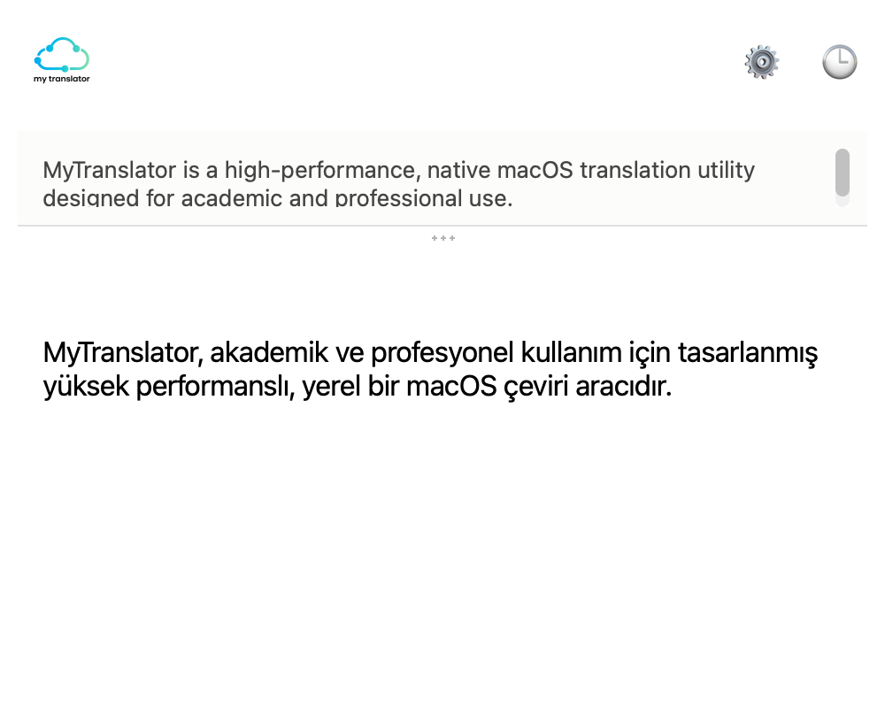
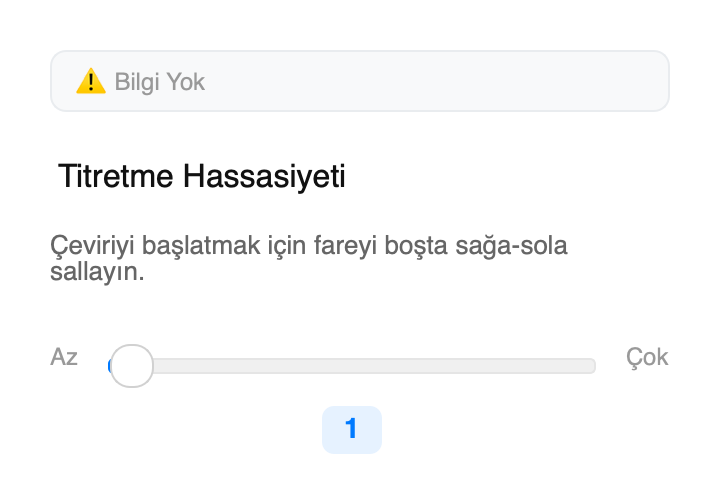
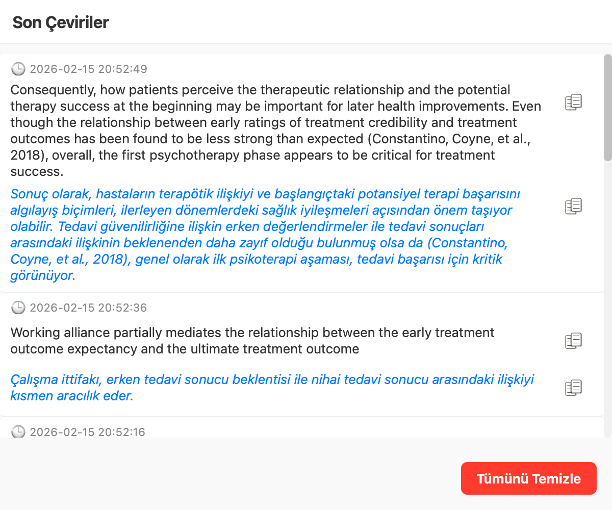

# MyTranslator 🚀


**MyTranslator** is a high-performance, native macOS translation utility designed for academic and professional use. It bridges the gap between your clipboard and advanced AI translation, offering instant, context-aware translations and academic style refinement.

## ✨ Key Features

### ⚡️ Ultra-Low Latency with Gemini 2.5 Flash-Lite

Powered by Google's latest **Gemini 2.5 Flash-Lite** model, MyTranslator is optimized for speed.

- **Instant Response:** Designed for sub-second query processing.
- **Smart Warmup:** Automatically establishes SSL/TLS tunnels upon launch to eliminate "cold start" latency.

### ✂️ Advanced Snipping Tool with OCR

Capture and translate text from anywhere on your screen, including images and protected documents.

- **Spotlight Visuals:** Features a modern "dimmed overlay" with a clear cutout for the selected area.
- **Dynamic Dimensions:** Shows real-time width/height of your selection.
- **Shake to Snip:** Trigger the tool instantly by shaking your mouse while holding the left click (Configurable).
- **Smart OCR:** Automatically strips hard line breaks from scanned text to ensure perfect formatting.

### ⌨️ Seamless "Double Copy" Trigger (Cmd+C+C)

Forget switching apps. Just highlight text and press `Cmd+C` twice.

- **Background Listening:** A lightweight background thread monitors keyboard events using `pynput`.
- **Smart Activation:** Detects the double-press pattern within a 0.5s window and instantly launches the translation popup.

### 🍎 Native macOS Integration

Built specifically for macOS, leveraging native APIs for maximum stability and performance.

- **Thread-Safe Clipboard:** Uses `NSPasteboard` (via `pyobjc`) for 10x faster clipboard access.
- **Focus Management:** Uses native `NSApplication` calls to steal focus instantly.
- **Agent Mode:** Runs silently in the background, hidden from the Dock.

### 🎓 Doğal Yazım (Academic Style Refinement)

Go beyond translation. **Doğal Yazım** copy-edits the translation so it reads as natural academic prose in its own language.

- **Translation Artefacts Removed:** Literal constructions, stock phrases and stacked connectors are edited out.
- **Meaning Preserved:** Claims, hedging, terminology, numbers and citations stay exactly as they are; nothing is added or removed.
- **Source-Checked:** The original text is sent along so the edit stays faithful to it.

## 📸 Screenshots

| Translation Popup | Settings Window |
|:---:|:---:|
|  |  |

| History Window |
|:---:|
|  |

## 🛠 Technical Architecture

- **Core:** Python 3.12+
- **GUI:** PyQt6 (Modern, responsive, and customizable)
- **Input Monitoring:** `pynput` (Global keyboard hook)
- **Clipboard/System:** `pyobjc-framework-Cocoa` (AppKit integration)
- **AI Engine:** `google-genai` SDK (Gemini 2.5 Flash-Lite)
- **Testing:** Comprehensive test suite with **72% Code Coverage** (96% Core Logic).

## 🚀 Installation & Usage

1. **Clone the Repository:**

    ```bash
    git clone https://github.com/yourusername/MyTranslator.git
    cd MyTranslator
    ```

2. **Install Dependencies:**

    ```bash
    pip install -r requirements.txt
    ```

3. **Set API Key:**
    Create a `.env` file in the root directory:

    ```env
    GEMINI_API_KEY=your_gemini_api_key_here
    ```

4. **Run:**

    ```bash
    python main.py
    ```

5. **Usage:**
    - **Text Translation:** Highlight text and press `Cmd + C` twice quickly.
    - **Image Translation:** Shake mouse while holding Left Click (or use the Snipping Tool from the tray menu).
    - **Doğal Yazım:** Click the **✨** button in the popup to refine the translation.

## 📄 License

This project is licensed under the MIT License - see the [LICENSE](LICENSE) file for details.
